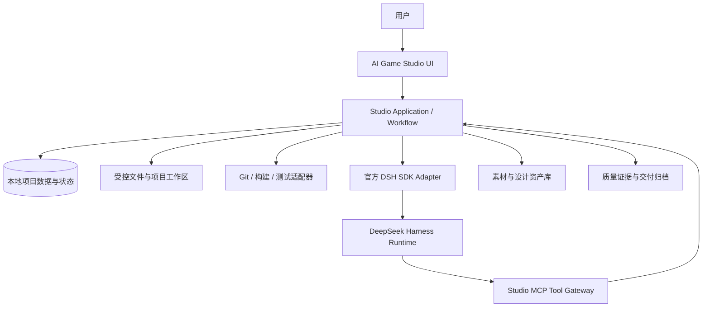

# 03｜系统架构与职责边界

## 总体分工

## Studio 负责

- 用户界面和交互状态。
- 项目/需求/设计/任务/审批/基线/证据的业务数据。
- 状态机、阶段门禁、权限、写入锁和构建锁。
- 项目文件系统、素材存储和索引。
- Prompt 模板、上下文包编译、知识引用追踪。
- Git、Cocos、微信工具、测试和构建等确定性操作的适配器。
- DSH Runtime 生命周期调用、会话映射和事件展示。
- 审计日志、错误处理、恢复和导出。

## DSH 负责

- 自然语言理解和多轮讨论。
- 竞品研究、资料分析、玩法建议。
- GDD/系统设计/UI 方案/技术方案草拟。
- 任务规划、代码生成和修改、Bug 分析。
- 测试报告分析、视觉审核辅助、影响分析。
- 调用 Studio 经授权暴露的工具。

## 设计规则

1. Studio 不把模型推理逻辑复制到业务代码中。
2. Studio 可以做确定性校验，不让模型决定权限、状态迁移或文件锁。
3. DSH 不直接绕过 Studio 访问任意项目目录；通过按项目/任务授权的工具和工作目录访问。
4. MCP Tool 只暴露必要能力；读、提案、写入、危险操作分权限层。
5. 任何 AI 输出都要标注来源、生成时间、Session、使用的上下文版本；正式内容需用户确认。
6. 业务状态以 Studio 数据库/状态文件为准，不能用 DSH Session 历史充当唯一项目状态。
7. Session 是执行/对话载体，不是任务本身；任务状态由 Studio 持久化。

## 建议的核心领域对象

- `GameProject`：游戏项目、目标平台、引擎、路径、配置。
- `IdeaDraft` / `Conversation`：想法、对话和草稿。
- `ResearchReport`：竞品、可行性、技术调研及来源。
- `RequirementBaseline`：冻结的需求版本。
- `DesignArtifact`：玩法/系统/UI/美术/数值设计及版本。
- `ChangeRequest`：变更申请、影响范围、审批结果。
- `AssetRecord` / `AssetUsage`：素材元数据、来源、许可、用途、使用位置。
- `Task` / `Milestone`：任务、依赖、契约、状态和执行者。
- `DSHSessionLink`：Studio 对话/任务与 DSH Session 的映射。
- `Approval` / `Decision`：业务审批与决策。
- `Evidence` / `BuildArtifact`：测试、截图、构建和来源证据。
- `ProjectEvent` / `Lock`：事件聚合、项目写锁和构建锁。

## 追溯关系

正式需求 → 设计产物 → UI/素材/代码模块 → 开发任务 → 测试用例 → 证据 → 交付清单。

当需求变更时，根据这条关系计算影响面，不允许让 Agent 只凭聊天记忆估计返工范围。

## 技术栈选择

本产品尚未锁定 UI 框架、桌面容器和本地数据库。PHASE 00 必须根据 Windows、DSH SDK、打包和本地文件能力完成技术验证，形成 ADR。不得未经验证直接把某个框架写成既定事实。
